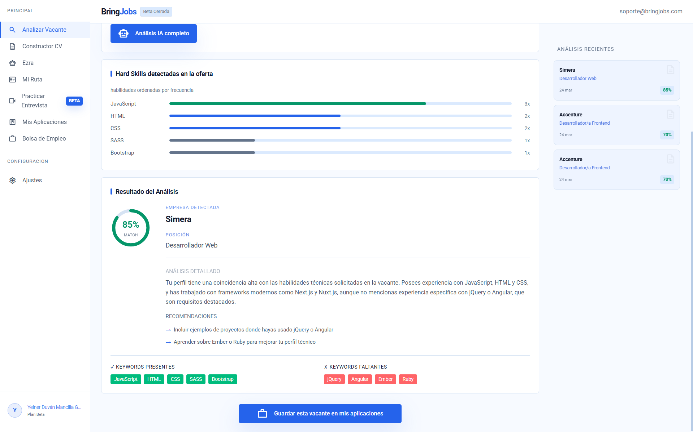
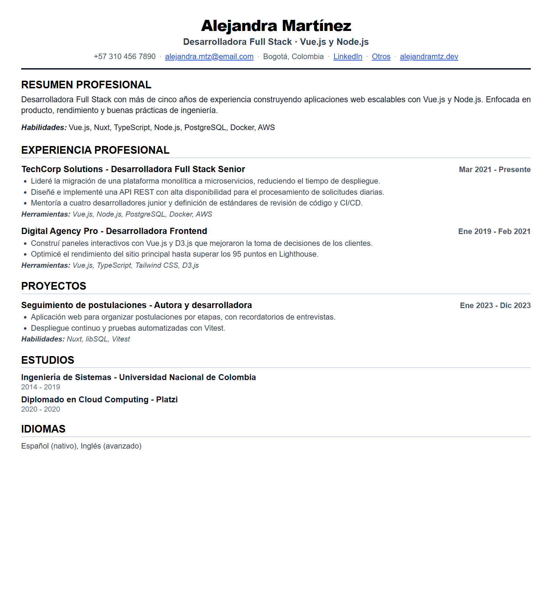
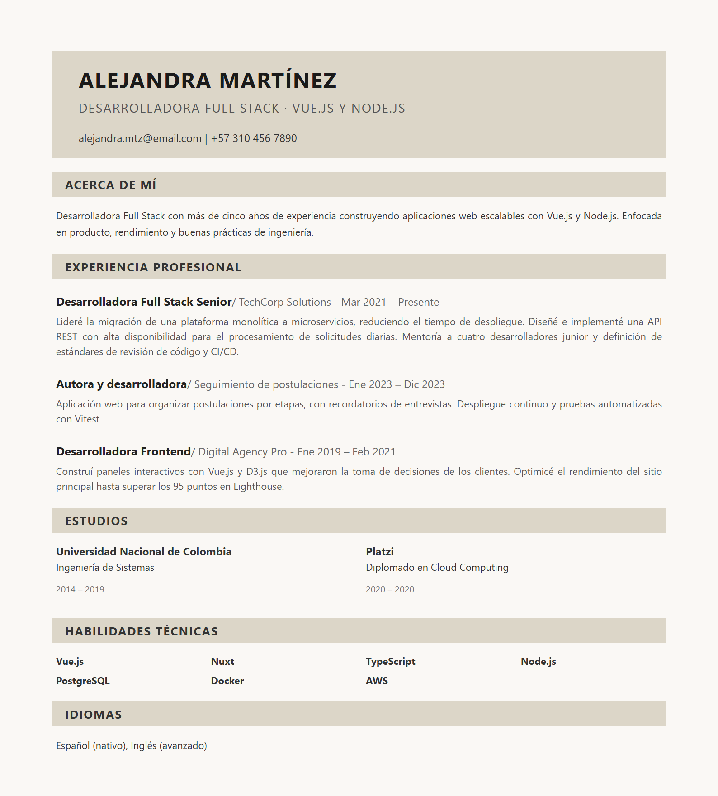
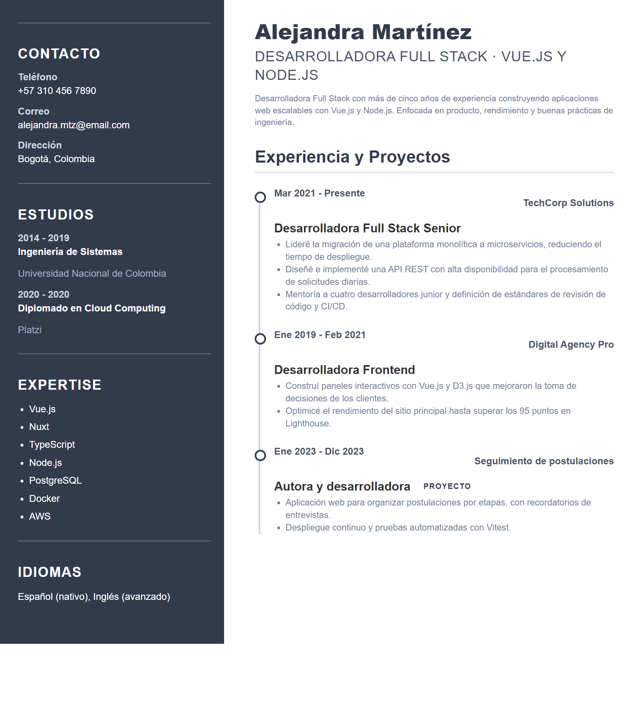
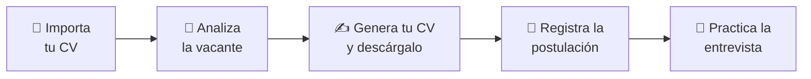
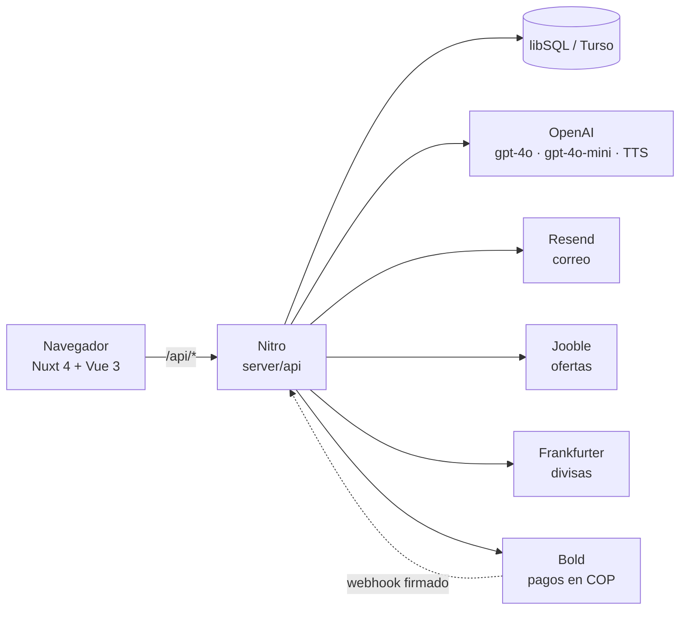

<div align="center">

# Bring Jobs

**Tu copiloto de IA para conseguir empleo.**
Optimiza tu CV frente a los filtros ATS, practica entrevistas con voz y organiza tus postulaciones, todo en un solo lugar.

[🚀 **Ver demo en vivo**](https://bringjobs.qaliby.com)




</div>

---

## ✨ ¿Qué es Bring Jobs?

Buscar empleo es repetitivo: adaptar el CV a cada vacante, adivinar qué palabras clave pide el filtro ATS, practicar entrevistas y no perder el hilo de dónde ya aplicaste.

**Bring Jobs junta todo eso en una sola app web.** Importas tu CV una vez y la IA te acompaña en cada paso, con reglas explícitas para que **no invente experiencia ni métricas** que no tienes.

## 🧰 Qué puedes hacer

| | Módulo | Qué hace |
|---|---|---|
| 📄 | **Importación de CV** | Sube tu CV en PDF: se extrae el texto, la IA lo estructura en tu perfil y te devuelve un diagnóstico de empleabilidad (fortalezas y oportunidades de mejora). Si el PDF es una imagen escaneada, te explica por qué un ATS lo descartaría y te ofrece crear uno desde cero. |
| 🔎 | **Análisis de vacante** | Pegas la oferta y obtienes un score de 0 a 100, las *hard skills* más pedidas ordenadas por frecuencia, las keywords que ya tienes frente a las que te faltan, y recomendaciones concretas. Todo queda en tu historial. |
| ✍️ | **Constructor de CV** | Adapta tu perfil maestro a la vacante: prioriza las experiencias más relevantes y reescribe tus logros con el lenguaje de la oferta. Tres plantillas, foto opcional y descarga en PDF A4 con **texto real** (seleccionable y extraíble, no una imagen). |
| 🤖 | **Ezra, tu coach** | Chat con una reclutadora de IA que conoce tu perfil y tus experiencias: estrategia de búsqueda, mejora del perfil y negociación salarial. |
| 🎤 | **Simulador de entrevista** *(beta)* | Entrevista guiada por IA con voz: puedes responder hablando, la IA te contesta con voz y al final recibes un reporte con el resumen del reclutador y sugerencias personalizadas. |
| 🧠 | **Examen de competencias** | 16 preguntas que identifican tus habilidades clave y completan tu perfil. |
| 🗺️ | **Mi Ruta** | Roadmap de tareas hacia tu objetivo profesional. El generador de CV las crea automáticamente a partir de cada vacante. |
| 📌 | **Mis aplicaciones** | Tracker por estados (Pendiente → Aplicado → Entrevista → Oferta / Rechazado) con programación de entrevistas. |
| 💼 | **Bolsa de empleo** | Búsqueda de ofertas en tiempo real con Jooble, con caché de 30 minutos. |
| 📊 | **Dashboard** | Score promedio, habilidades del mercado frente a las tuyas, *quick wins* (qué skill agregar para subir más), embudo de conversión e índice de *market fit*. |
| 🎁 | **Prueba sin registro** | Un visitante sube su CV y ve su diagnóstico y su match con una vacante real, sin crear cuenta. Al registrarse, el resultado se migra a su cuenta. |

### Plantillas de CV

<table>
  <tr>
    <td align="center" width="33%">
      <br>
      <b>Clásica</b><br>
      <sub>Diseño profesional con foto, secciones claras y formato ATS-friendly.</sub>
    </td>
    <td align="center" width="33%">
      <br>
      <b>Minimalista</b><br>
      <sub>Estilo elegante con banner, tonos crema y distribución moderna.</sub>
    </td>
    <td align="center" width="33%">
      <br>
      <b>Doble columna</b><br>
      <sub>Diseño editorial con barra lateral oscura y experiencia destacada.</sub>
    </td>
  </tr>
</table>

<sub>Renderizadas con los componentes reales de la app y datos ficticios.</sub>

## 🔄 Cómo fluye



## 🏗️ Arquitectura



| Capa | Tecnología |
|---|---|
| **Frontend** | Nuxt 4 · Vue 3 (Composition API, `<script setup>`) · Tailwind CSS 4 · Material Symbols |
| **Backend** | Nitro (rutas en `server/api`) con SQL directo, sin ORM |
| **Datos** | libSQL / Turso (SQLite). El esquema se crea solo y de forma idempotente en el primer arranque |
| **Autenticación** | nuxt-auth-utils (sesiones cifradas) · bcrypt · verificación por código · Google OAuth |
| **IA** | OpenAI: `gpt-4o` (generar CV, coach, entrevista) · `gpt-4o-mini` (análisis, auditoría, importación) · `tts-1-hd` (voz) |
| **Documentos** | unpdf (leer PDF) · jsPDF + html2canvas (exportar PDF) · marked (Markdown) |
| **Pagos** | Bold (Colombia), con webhooks firmados |
| **Servicios** | Resend (correo) · Jooble (ofertas) · Frankfurter (tasas de cambio) |
| **i18n** | `@nuxtjs/i18n`, interfaz en español e inglés |
| **Calidad** | Vitest |

## 🧠 Decisiones de ingeniería

- **La IA no inventa.** El prompt de generación prohíbe inventar métricas, limita las *skills* a las que el usuario ya listó, y distingue empleos formales de proyectos personales. En el análisis, `keywords_presentes` solo puede contener habilidades que existan de verdad en el perfil. Ezra tiene la misma regla.
- **PDF con texto real, no una captura.** El CV se exporta en el navegador con jsPDF y el texto sigue siendo texto. Al extraerlo con `unpdf`, la plantilla Clásica conserva intactos el nombre, las secciones, las empresas y las habilidades.
- **Seguridad por capas.**
  - Contraseñas con bcrypt y verificación de correo por código.
  - Rate limiting: 10 intentos cada 15 min por IP en login, registro, verificación y recuperación; 30 llamadas de IA por hora por usuario; 10 por hora por IP en la prueba anónima.
  - Webhook de pagos con verificación de firma HMAC-SHA256, comparación en tiempo constante e idempotencia por transacción.
  - Markdown generado por IA sanitizado con lista blanca de etiquetas.
  - Lista blanca de columnas en las migraciones de esquema.
  - Cabeceras HTTP de seguridad (`X-Frame-Options`, `nosniff`, `Referrer-Policy`, `Permissions-Policy`).
- **Del visitante anónimo al usuario registrado.** El trial funciona sin cuenta y, al registrarse (con correo o con Google), esos datos se migran a la cuenta nueva.
- **Pensado para Colombia y para el mundo.** Cobros en COP, conversor de divisas con caché y preselección de moneda según el país del visitante, e interfaz bilingüe.
- **Códigos de descuento con atribución.** Cada vendedor tiene su código y cada venta queda atribuida a él.
- **Specs antes que código.** Las funciones grandes nacieron de un diseño y un plan escritos en [`docs/superpowers`](docs/superpowers):
  [prueba sin registro](docs/superpowers/specs/2026-06-11-free-trial-design.md) ·
  [login con Google](docs/superpowers/specs/2026-06-17-google-login-design.md) ·
  [conversor de divisas](docs/superpowers/specs/2026-06-18-currency-converter-design.md) ·
  [códigos de descuento](docs/superpowers/specs/2026-06-18-discount-codes-bold-design.md) ·
  [guía para CVs ilegibles](docs/superpowers/specs/2026-06-17-cv-incompatible-guidance-design.md)

## 🚀 Cómo correrlo en local

**Requisitos:** Node.js `^20.19` o `>=22.12` y una API key de [OpenAI](https://platform.openai.com/api-keys).

```bash
git clone https://github.com/DuvanLT/Curriculum-Master.git
cd Curriculum-Master
npm install
cp .env.example .env      # añade tu NUXT_OPENAI_API_KEY
npm run dev               # http://localhost:3000
```

El [`.env.example`](.env.example) ya apunta a una base SQLite local (`file:./local.db`), así que **no necesitas cuenta de Turso** para desarrollar. Las tablas se crean solas en la primera petición a la API.

### Variables de entorno

Todas están documentadas, con dónde conseguir cada clave, en [`.env.example`](.env.example). Lo esencial:

| Variable | ¿Obligatoria? | Para qué |
|---|---|---|
| `NUXT_TURSO_URL` · `NUXT_TURSO_TOKEN` | Sí | Base de datos (en local: `file:./local.db`) |
| `NUXT_OPENAI_API_KEY` | Sí | Todas las funciones de IA |
| `NUXT_SESSION_PASSWORD` | En producción | Cifrado de sesiones (en desarrollo se genera sola) |
| `NUXT_RESEND_API_KEY` | Para registrarse con correo | Códigos de verificación y recuperación de contraseña |
| `NUXT_OAUTH_GOOGLE_*` | No | Inicio de sesión con Google (`CLIENT_ID` y `CLIENT_SECRET`) |
| `NUXT_JOOBLE_API_KEY` | No | Bolsa de empleo |
| `NUXT_BOLD_ID` · `NUXT_BOLD_SECRET` | No | Cobros del plan Pro |
| `NUXT_API_TOKEN` | No | Llamar a la API sin sesión (por ejemplo, desde un cron) |

> **Sin `NUXT_RESEND_API_KEY`** no salen correos: el código de verificación queda guardado en la columna `users.verification_code` de tu base local.
>
> **Ojo con `NUXT_TEST_BOLD_ID`:** activa el modo de pruebas de Bold. Úsala solo en tu máquina y nunca la definas en producción.
>
> Tu `.env` ya está en el `.gitignore`. No lo subas nunca.

### Scripts

| Comando | Qué hace |
|---|---|
| `npm run dev` | Servidor de desarrollo |
| `npm run build` | Build de producción |
| `npm run preview` | Previsualiza el build |
| `npm test` | Corre las pruebas con Vitest |

## 🧪 Pruebas

```bash
npm test
```

Cubren la lógica de dominio del servidor (precios y descuentos, caché y conversión de divisas, importación de CV, borrado de cuenta, usuarios de Google, migración del trial), los mensajes de error de auth e importación, y el render de las tres plantillas de CV.

## 📁 Estructura

```text
app/                     Frontend Nuxt
├─ pages/                Una página por módulo
├─ components/templates/ Las 3 plantillas de CV
├─ composables/          Estado, auth, suscripción, toasts…
└─ utils/                Localización de CV, Markdown seguro…
server/
├─ api/                  Endpoints: IA, auth, checkout, webhooks, trial, divisas…
├─ middleware/           Auth global, rate limit, inicialización de la base de datos
└─ utils/                Lógica de dominio: db, precios, descuentos, trial, divisas…
shared/                  Código compartido cliente/servidor (conversión de divisas)
i18n/locales/            es.json · en.json
tests/                   Pruebas con Vitest
docs/superpowers/        Diseños (specs) y planes de implementación
```

## 🛣️ En el horizonte

- **Ajuste determinista del CV generado:** una hoja bien llena por defecto y una segunda solo cuando esté justificada, medido y verificable en vez de depender del prompt *(en diseño)*.
- **Experiencias activables:** desactivar una experiencia sin borrarla, para excluirla de la generación del CV *(en diseño)*.

## 👤 Autor

Hecho en Colombia por **Duván Mancilla** ([@DuvanLT](https://github.com/DuvanLT)).

Si el proyecto te sirvió o te gustó, ¡regálale una ⭐!
